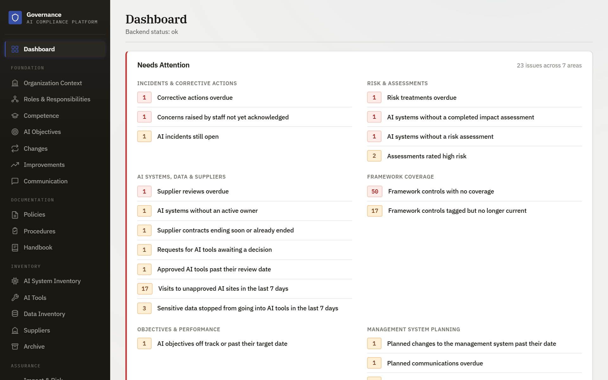
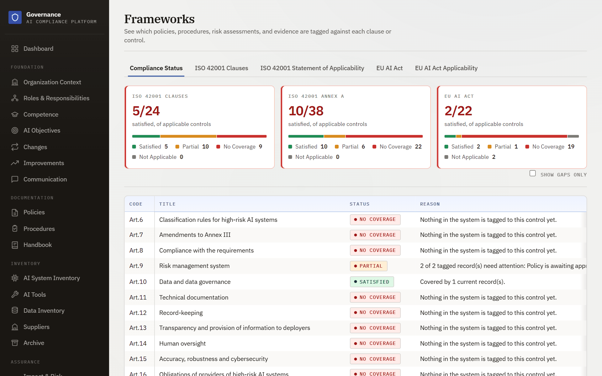
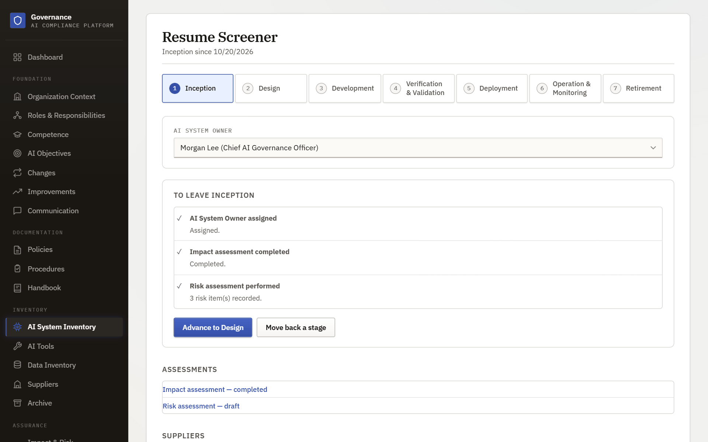
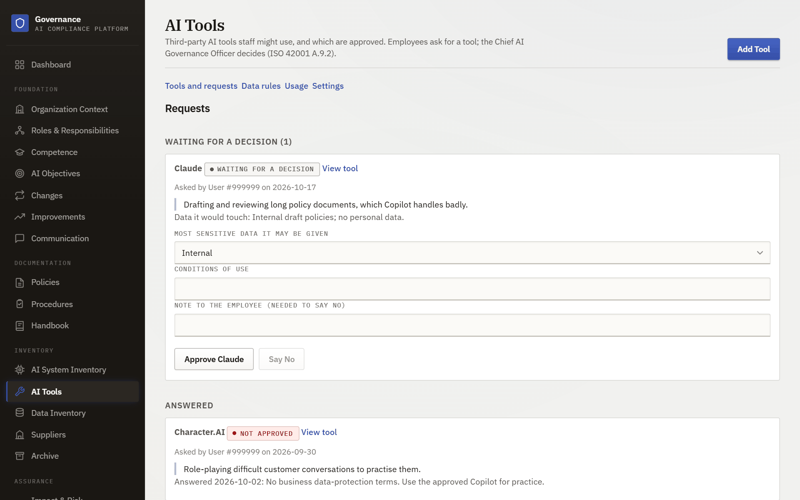
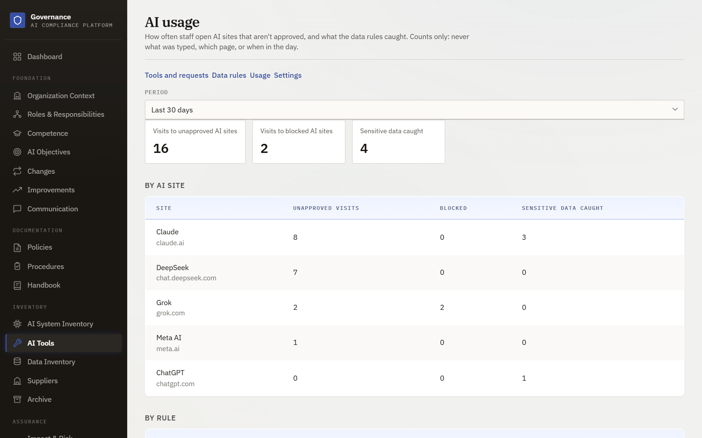

# AI Governance Platform

[](https://github.com/ArhamMirza/ai-governance-platform/actions/workflows/ci.yml)
[](LICENSE)

Run an AI management system in line with **ISO/IEC 42001** and the **EU AI Act**, and govern
how staff actually use AI tools. One organization per deployment, running locally:
a React frontend, a FastAPI backend, and a single SQLite file.

> **Status.** A portfolio project, built to explore AI governance end to end. It has had
> no independent security review and is **not ready to hold a real organization's data**;
> see [SECURITY.md](SECURITY.md) for what is and isn't covered. The demo data
> (`python -m app.seed`) is entirely fictional.

<picture>
  <source media="(prefers-color-scheme: dark)" srcset="docs/images/dashboard-dark.png">
  
</picture>

## What it does

**The management system.** The records an auditor asks for, with approvals and an audit trail:

- Organization context, policies and procedures (folders of documents moving through
  draft → review → approved), evidence and a Statement of Applicability.
- An **AI system inventory** with a seven-stage life cycle. Each stage has a gate computed
  from the records that already exist, so it cannot pass while the evidence is missing.
- **Impact assessments** (ISO/IEC 42005 factors) and **risk assessments**, with a
  two-stage approval chain and a separate sign-off by the Chief AI Governance Officer.
- Objectives, competence, communication, change planning, internal audits, management
  review, corrective actions, improvements, incidents, concerns raised by staff, suppliers.
- A **compliance view** that computes, live, how well each ISO 42001 clause, Annex A control
  and EU AI Act article is covered. Nothing is a tick-box: status follows the records.

**Governing staff use of AI.** A register of approved AI tools that employees request and
the Chief AI Governance Officer decides, data-loss-prevention rules, and a **Chrome/Edge
extension** that blocks or warns on unapproved AI sites and stops sensitive text being
pasted into AI chats. It reports daily counts only (never the text), and a Usage page
shows who has it installed and how often people go ahead past a warning.

**An optional assistant.** Search and chat over the record, with citations that are checked
before you see them, and drafting help. It can read and propose; it cannot change
anything. Search runs on this machine; a model provider is only called if you configure one.

<table>
  <tr>
    <td width="50%"><br><sub><b>Compliance status</b>, computed from the records tagged to each control.</sub></td>
    <td width="50%"><br><sub><b>Life cycle gates</b>, each requirement computed live.</sub></td>
  </tr>
  <tr>
    <td width="50%"><br><sub><b>AI tool register</b>: employees ask, the CAIGO decides.</sub></td>
    <td width="50%"><br><sub><b>AI usage</b>: counts from the extension, never content.</sub></td>
  </tr>
</table>

## Documentation

| | |
|---|---|
| [DESIGN.md](DESIGN.md) | Architecture, data model, design principles and the decisions behind them. |
| [SECURITY.md](SECURITY.md) | How to report a vulnerability, what is defended, and the known limits. |
| [extension/README.md](extension/README.md) | The browser extension: what it can and can't do, rollout, and the test guide. |
| [deploy/README.md](deploy/README.md) | Production settings, reverse-proxy configuration (Caddy, nginx), and first start. |
| In the app: **Handbook** | The operating manual: who does what, the life cycle and its gates, reading the dashboard. |

## Stack

- **Frontend**: React 19, TypeScript, Vite, TanStack Query, react-hook-form and zod; feature-based folders
- **Backend**: FastAPI (Python 3.11+), SQLAlchemy and Alembic, layered
  routers → services → repositories
- **Database**: SQLite, with FTS5 (keyword search) and sqlite-vec (vector search) in the same file
- **Search models**: small ONNX models for embeddings, reranking and OCR, run on the CPU
- **Extension**: Manifest V3, TypeScript, one build for Chrome and Edge

## Getting started

You need Python 3.11+ and Node 22+.

### Backend

```bash
cd backend
python -m venv .venv
.venv\Scripts\activate      # Windows (macOS/Linux: source .venv/bin/activate)
pip install -e ".[dev]"
cp .env.example .env
alembic upgrade head
uvicorn app.main:app --reload
```

API docs are at `http://localhost:8000/docs` while `ENVIRONMENT=development`.

### Frontend

```bash
cd frontend
npm install
cp .env.example .env
npm run dev
```

The app is at `http://localhost:5173`. On first run it asks you to create the first
account, which becomes the administrator.

### Demo data

```bash
cd backend
python -m app.seed
```

Fills in a few policies, procedures, AI systems, assessments, AI tools, data rules and two
weeks of usage counts, through the real service layer (so audit history and computed
values come out right). Everything is fictional. Safe to run more than once: it skips if
the database already has policies in it.

### Optional: the assistant

*Settings* has the AI provider (Anthropic, OpenAI, Gemini, Groq, or a local server), its
key (stored encrypted) and a daily token budget. Without one, the rest of the app works
as normal. The small local search models are downloaded once, the first time they are needed (indexing a
document, or suggesting framework tags), so that first use needs a network connection.

### Optional: the browser extension

See [extension/README.md](extension/README.md): build it, load it unpacked, and follow the
laptop try-out. It needs an enrollment key from *AI Tools → Settings*.

## Testing

```bash
# backend (about 2,000 tests)
cd backend && pytest --cov=app

# frontend (about 800 tests)
cd frontend && npm test

# extension (about 180 tests)
cd extension && npm test
```

A real-browser test loads the built extension into Chrome or Edge against a running
platform: see [extension/e2e/README.md](extension/e2e/README.md).

## Governing staff use of AI tools

- **Register of AI tools**: which third-party tools are approved, with the most sensitive
  data each may be given. Employees ask for a tool from their staff login; the Chief AI
  Governance Officer decides, and nobody decides their own request.
- **Data rules (DLP)**: what must not be pasted or typed into AI tools (card numbers,
  keys, personal identifiers, your own keywords or patterns), each set to monitor, warn or
  block. The rules are evaluated in the employee's browser; the text never reaches the server.
- **Browser extension** (`extension/`, Chrome and Edge): carries it out. Unapproved AI sites
  are **blocked by default** (warn or monitor are settings), and counts are reported, never
  content. See [extension/README.md](extension/README.md) for what it can and can't do and
  how to roll it out.

## Security

### Accounts and sign-in

- **Passwords** need at least 12 characters and are refused if they are a common
  word (even dressed up, like `P@ssw0rd2024!`), a keyboard or number run, almost
  all one character, or built from the person's own name or email. The last five
  passwords can't be reused.
- **Temporary passwords.** An account an administrator creates, or whose password
  they reset, can do nothing but choose a new password at first sign-in. Existing
  accounts whose password falls short of the rules are asked to change it the same way.
- **Resetting.** *Users → Reset password* issues a one-time password, shown once and
  never stored readably, and signs the person out everywhere. A password an administrator
  issued and nobody has used stops working after seven days.
- **Importing staff.** *Users → Import from CSV* adds and updates accounts from a file
  (name, email, optional role), with a preview first. Re-uploading a corrected file is
  safe; a file can never create or change an administrator or deactivate anyone.
- **Sessions** end everywhere when a password is changed or reset, a role is changed,
  or an account is deactivated. *Your account* has "Sign out of other devices".
- **Lockout.** Five wrong passwords lock an account for 15 minutes; 20 wrong attempts
  from one address block that address. Behind a reverse proxy, forward the real client
  address (`uvicorn --proxy-headers`) or every user will appear to share one.
- **Audit trail.** Sign-ins, failed sign-ins, lockouts, sign-outs, password changes and
  resets are recorded against the account (with the address), in the audit log.

### Two-step sign-in

Anyone can turn on an authenticator app (Google or Microsoft Authenticator, Authy,
1Password) under *Your account*; administrators can require it of administrators.

- **Setting up**: scan a QR code (or type the key), enter one code to prove it works, then
  save ten single-use **recovery codes**, shown once. The secret is stored encrypted and the
  recovery codes only as hashes. Nothing is on until the first code is accepted.
- **Signing in**: a correct password gets no session, only a five-minute signed ticket; a
  current code (or a recovery code) turns it into the session. A code works once. Five wrong
  codes lock the account's codes for 15 minutes, and entering the password again does not
  give fresh guesses. Sign-ins, failures, lockouts and recovery-code use are in the audit log.
- **Turning it off or making new recovery codes** needs the password *and* a current code.
- **Lost phone and recovery codes**: another administrator uses *Users → Reset two-step*
  (logged; signs the person out everywhere). Nobody can reset their own.
- **Requiring it for administrators** (*Users → Sign-in security*, off to begin with): an
  administrator without it is held at the set-up screen until they turn it on. It can only be
  switched on by an administrator who has it on themselves, so it cannot lock everyone out.
- **Limits**: codes can be phished (a hardware key would not be); rotating `SECRET_KEY`
  makes stored secrets unreadable, so people must then use a recovery code or be reset; the
  rate limits are in memory and reset when the API restarts.

### Hardening for a real deployment

With `ENVIRONMENT=production` (or `staging`) the platform is stricter, and
[deploy/](deploy/README.md) has the proxy configuration to go with it:

- **First account needs a setup code**, printed in the server's log at startup (or set
  as `SETUP_CODE`), so whoever reaches a new server first can't claim it.
- **Every response carries protective headers**: `nosniff`, `X-Frame-Options: DENY`,
  `Referrer-Policy`, `Permissions-Policy`, a policy that makes downloaded files inert,
  `Cache-Control: no-store`, and HSTS when cookies are secure.
- **The session cookie** is `HttpOnly`, `SameSite=Strict`, and (over https) carries the
  browser-enforced `__Host-` prefix.
- **Cross-site requests are refused**: a state-changing request carrying the session
  cookie from another website's origin gets a 403, on top of SameSite and CORS.
- **CORS** allows only the listed origins (a wildcard is refused at startup), and only
  the methods and headers the app uses.
- **The API docs are switched off**, and the demo-data loader refuses to run unless
  told `--allow-production`.
- The built frontend works under a strict Content-Security-Policy (no inline scripts);
  CI checks the built page.

## Repository layout

```
backend/     FastAPI app (routers, services, repositories, models), Alembic migrations, tests
frontend/    React app, one folder per feature
extension/   Chrome/Edge extension, and e2e/ the real-browser test
deploy/      Reverse-proxy examples and production settings
docs/        Screenshots used in this README
DESIGN.md    Architecture and decisions        SECURITY.md   Reporting and known limits
```

## Git Workflow

- `main` is protected and always kept working — changes land via Pull Request,
  not direct pushes, with the CI checks green.
- One feature branch per vertical slice: `feat/<short-name>` (or `fix/`, `chore/`,
  `docs/`, `test/` for their respective purposes). Push the branch and open a PR
  rather than merging locally.
- Commit messages follow [Conventional Commits](https://www.conventionalcommits.org/):
  `feat: add policy approval workflow`, `test: cover risk score edge cases`, etc.
- Keep commits small and logically scoped — one concern per commit.
- Work is tracked as GitHub Issues; PRs reference the issue they close
  (`Closes #12`).

## CI/CD

- **CI** (`.github/workflows/ci.yml`): every PR and push to `main` runs three jobs —
  backend (`ruff`, `pip-audit`, `pytest`), frontend (`oxlint`, `npm audit`, `vitest`,
  production build, and a check that the built page works under a strict
  Content-Security-Policy) and extension (`oxlint`, `npm audit`, `vitest`, build). Branch
  protection requires all three to pass before a PR can merge.
- **Code scanning and secrets** (`.github/workflows/security.yml`): CodeQL for Python and
  TypeScript, and a secret scan of the full history, on every PR and weekly. Actions are
  pinned to commit hashes, and Dependabot keeps them and the dependencies current.
- **Releases** (`.github/workflows/release.yml`): pushing a tag matching
  `v*.*.*` (e.g. `v0.1.0`) auto-creates a GitHub Release with notes generated
  from the commit history since the last tag.
  ```bash
  git tag v0.1.0
  git push origin v0.1.0
  ```
  There's no separate deployment step — this is a locally-run app, so a
  "release" just marks a known-good, tagged snapshot of the code. A container
  setup and a managed database are listed under *Not built yet* in
  [DESIGN.md](DESIGN.md#13-not-built-yet).

## License

Apache License 2.0 — see [LICENSE](LICENSE).
